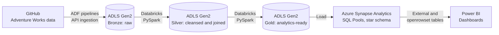

# Azure Data Engineering Pipeline (Adventure Works Dataset)
 
A cloud-native ETL pipeline built on Azure that simulates an enterprise data engineering workflow. It pulls raw data from GitHub, processes it through a bronze-silver-gold medallion architecture, loads it into a star schema in Azure Synapse Analytics, and serves it to Power BI dashboards.
 
## Overview
 
The goal of this project was to practice the full data engineering lifecycle on Azure: ingestion, transformation, warehousing, and reporting. The Adventure Works dataset (multi-table sales and customer data) is ingested automatically through an API, cleaned and joined with PySpark, modeled for analytics, and visualized in Power BI.
 
## Architecture
 

 
## Pipeline Steps
 
1. **Ingestion (Azure Data Factory)**
   - ADF pipelines pull the source data from GitHub endpoints through an API connection
   - Data lands in Azure Data Lake Storage Gen2 and the ingestion is fully automated
2. **Medallion architecture (ADLS Gen2)**
   - **Bronze:** raw data exactly as received
   - **Silver:** cleansed and joined data
   - **Gold:** curated, analytics-ready data
   - Keeping the three layers separate keeps raw, transformed, and reporting data apart
3. **Transformation (Databricks and PySpark)**
   - Cleansed the data and joined multiple sales and customer tables
   - Prepared the curated datasets and loaded them into Azure Synapse Analytics (SQL Pools)
4. **Data modeling and warehousing (Azure Synapse Analytics)**
   - Designed a star schema to speed up queries and reporting
   - Created external tables and `OPENROWSET` queries over the data lake
   - Connected Synapse to Power BI for end-user analytics
5. **Reporting (Power BI)**
   - Built dashboards that track sales KPIs and operational trends
## Tech Stack
 
| Area | Tools |
|---|---|
| Orchestration and ingestion | Azure Data Factory (ADF) |
| Storage | Azure Data Lake Storage Gen2 (ADLS Gen2) |
| Processing | Azure Databricks, PySpark |
| Warehousing | Azure Synapse Analytics (SQL Pools) |
| Modeling and querying | Star schema, SQL, external tables, OPENROWSET |
| Visualization | Power BI |
 
## What I Learned
 
- Building and automating ingestion pipelines with ADF
- Organizing a data lake with a medallion architecture
- Cleaning and joining multi-table data at scale with PySpark
- Designing a star schema for reporting workloads
- Connecting a data warehouse to a BI tool for end users
